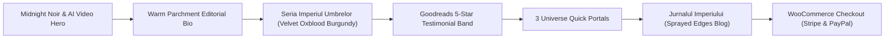

# 🥀 Christiana Ciocan — Dark Romance Author Portal & E-Commerce Store

[](https://wordpress.org)
[](https://elementor.com)
[]()
[]()
[]()

An immersive, high-conversion **Dark Romance Author & E-Commerce Platform** crafted for international bestselling dark romance and gothic fiction author **Christiana Ciocan** (*Seria Imperiul Umbrelor*, *Păcatul Casei Vartai*, *Speranța are numele tău*). 

Designed for direct reader-to-author book sales (eBooks, Paperbacks, and Deluxe Sprayed Edges editions), with an **edge-to-edge mobile AI video hero carousel** inspired by *CalypsoBooks.ro*, integrated Stripe and PayPal checkout, and an editorial dark luxury aesthetic.

---

## 📸 Key Design & Architecture Highlights



- **CalypsoBooks Edge-to-Edge Video Carousel:** Zero-border, 100vw full-bleed mobile video carousel using `playsinline webkit-playsinline` for seamless inline playback across iOS and Android without triggering full-screen popups.
- **Editorial Luxury Color Hierarchy:** Alternating rhythm between Deep Noir (`#070608`), Italian Warm Parchment (`#f6f3eb`), Royal Velvet Oxblood Burgundy (`#480c19`), and Metallic Gold foil accents.
- **Direct WooCommerce Sales:** Variable product configuration supporting:
  - **Digital eBooks:** Instant DRM-free digital downloads (EPUB, MOBI, PDF) with automated branded confirmation emails.
  - **Signed Paperbacks & Hardcovers:** Physical shipping classes, weight rules, and custom packaging notes (wax seals, author ribbons).
  - **Deluxe Editions:** Limited print runs with custom sprayed/printed edges (*margini colorate*).
- **Interactive Chapter Reader:** Built-in modal excerpt reader allowing fans to preview Chapter 1 in atmospheric parchment styling.
- **Card Payments via Stripe ($0 Plugin Cost):** Full integration instructions for the official WooCommerce Stripe Gateway (0% monthly subscription markup) supporting Visa, Mastercard, Apple Pay, and Google Pay.
- **Scalable Vector Suite:** Handcrafted SVG logos ([`logo-vector.svg`](assets/images/logo-vector.svg), [`logo-mark.svg`](assets/images/logo-mark.svg), [`logo-white.svg`](assets/images/logo-white.svg), [`favicon.svg`](assets/images/favicon.svg)) based on the client's signature emblem.

---

## 📂 Project Structure

```bash
Dark Romance Author WordPress Site/
│
├── index.html                    # Homepage (Edge-to-Edge Hero, Book Grid, Bio, Jurnal)
├── book-single.html              # Dedicated Single Product Page (Păcatul Casei Vartai)
├── books.html                    # Complete Novel Catalog & Chronological Reading Order
├── about.html                    # Author Biography, Aesthetic Vision & Reader FAQ
├── blog.html                     # Jurnalul Imperiului (Writing Teasers & Sprayed Edges)
├── blog-single.html              # Populated Sample Article (Precomandă Păcatul Casei Vartai)
├── contact.html                  # Secure Reader Contact Form & ARC Team Application
├── checkout.html                 # WooCommerce Seamless Checkout Demo (Stripe & PayPal)
│
├── assets/
│   ├── css/
│   │   └── style.css             # Full Luxury Responsive Styling & Flexbox Layouts
│   ├── js/
│   │   └── main.js               # Touch Swipe Carousel, Cart Drawer, Excerpt Modals
│   └── images/
│       ├── logo-vector.svg       # Full Scalable Gold Metallic Vector Logo
│       ├── logo-mark.svg         # Signature Emblem (Pen Nib, Dragon Wing, Rose, CC)
│       ├── logo-white.svg        # Clean Monochrome White Vector
│       ├── favicon.svg           # High-DPI Browser Icon
│       ├── author-signature.svg  # Custom Cursive Burgundy Script Signature
│       ├── christiana-ciocan-portrait.jpg # Authentic Author Portrait
│       ├── pacatul-casei-vartai-hero.jpg  # Widescreen Masked Hooded Hero Visual
│       ├── speranta-are-numele-lui-cover.jpg # 3D Photorealistic Cover (Vol. 1)
│       ├── pacatul-casei-vartai-cover.jpg    # 3D Photorealistic Cover (Precomandă)
│       ├── mostenirea-sinistra-cover.jpg     # 3D Photorealistic Cover (Vol. 2)
│       ├── darul-sangelui-cover.jpg          # 3D Photorealistic Cover (Vol. 3)
│       └── eleonora-speranta.jpg             # Ultra-HD Sprayed Edges Book Photograph
│
├── WORDPRESS_SETUP_GUIDE.md      # Technical Elementor & WooCommerce Deployment Manual
├── CLIENT_HANDOFF_GUIDE.md       # Client User Guide (Adding Books, Coupons, Orders)
├── CLIENT_PROPOSAL.md            # Freelancer.com High-Converting Bid & Cover Letter
└── README.md                     # Repository Documentation
```

---

## 🚀 Quick Start / Local Preview

1. **Clone this repository:**
   ```bash
   git clone https://github.com/your-username/dark-romance-author-wordpress-site.git
   cd dark-romance-author-wordpress-site
   ```

2. **Open in Browser:**
   - Double-click [`index.html`](index.html) or open it with **Live Server** in VS Code.
   - All assets, scripts, and fonts are self-contained and run out of the box with zero npm dependencies required.

---

## 🛠️ WordPress & Elementor Deployment

For deploying to production WordPress hosting:

1. **Theme:** Install **Hello Elementor** (or a clean Astra child theme).
2. **Plugins:** Install **WooCommerce**, **Elementor** (Free or Pro), **WooCommerce Stripe Gateway**, and **Fluent Forms**.
3. **Edge-to-Edge Hero:** Set the main Elementor container width to `Full Width`, `Padding: 0`, and apply the mobile full-bleed CSS snippet from [`WORDPRESS_SETUP_GUIDE.md`](WORDPRESS_SETUP_GUIDE.md).
4. **Variable Products:** Follow the step-by-step instructions in [`CLIENT_HANDOFF_GUIDE.md`](CLIENT_HANDOFF_GUIDE.md) to add digital eBooks and physical paperbacks.

---

## 📜 Documentation

- 📘 [**WordPress & Elementor Setup Guide**](WORDPRESS_SETUP_GUIDE.md) — Comprehensive technical configuration steps.
- 📙 [**Client Hand-off & Maintenance Manual**](CLIENT_HANDOFF_GUIDE.md) — Non-technical guide for author self-maintenance.
- 💼 [**Winning Client Proposal**](CLIENT_PROPOSAL.md) — Ready-to-send proposal for Freelancer.com.

---

## ✒️ Author & Brand Credits

- **Author Brand:** [Christiana Ciocan](https://instagram.com) (*Dark Romance Author*)
- **Series:** *Seria Imperiul Umbrelor*
- **Design & Code:** Prepared for professional WordPress + WooCommerce deployment.

---

*Licensed under the [MIT License](LICENSE).*
